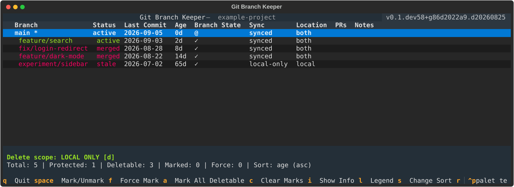

# 🌿 Git Branch Keeper (GBK)

[](LICENSE)
[](https://www.python.org/downloads/)

**Review and clean up Git branches from your terminal.** GBK identifies merged and stale branches, shows their local/remote status, and lets you review cleanup in an interactive terminal interface or a plain CLI report.

Works with any Git repository, including GitHub, GitLab, Bitbucket, and local repositories. Optional GitHub authentication adds pull-request status and protection for branches with open PRs.

## Install and try it

Requires **Git 2.39+**, **Python 3.12+**, and [pipx](https://pipx.pypa.io/stable/installation/).

```bash
pipx install 'git+https://github.com/lsdcapital/git-branch-keeper.git'
cd your-git-repo
gbk
```

Install directly from GitHub; GBK is not currently published on PyPI. The commands `gbk`, `git gbk`, and `git-branch-keeper` all launch the same tool.

Navigate with **↑/↓**, use **Space** to mark or unmark a branch, then **Enter** to review the deletion confirmation. Press **q** to quit. Remote deletion is off by default.

For a read-only first look:

```bash
gbk --cli --filter merged
```



*The actual GBK interface, rendered with sample branch data.*

The TUI opens in **Local** view. Click **Local**, **Remote**, or **All**, or press
`v` to cycle views. Local shows local branches and worktrees; Remote shows branches
on the selected remote; All combines them with one branch row per name and a
local/remote/both location. Changing views clears selections and does not enable
remote deletion. Local cleanup keeps remote refs; in Remote or All, review the
verified remote cleanup with `d`. It marks candidates for review; Enter opens
the deletion confirmation.

Local startup analyzes local branches only. Remote-only analysis loads when you
first open Remote or All. Pressing `r` refreshes the current view; Local refresh
does not fetch the remote. Local branches still receive their normal PR checks.

**Status** describes branch history; **Cleanup** explains restrictions such as
“remote deletion is disabled” or “merge not confirmed.” Remote tips already
reachable from main with uncertain merge history display **already in main**
instead of **unstarted**; this label alone does not authorize cleanup.

## What it helps with

- **Find cleanup candidates:** Detect merged changes, including squash and rebase workflows, and identify inactive branches.
- **Review before deleting:** See branch status, inspect details, and preview cleanup with a dry run.
- **Manage worktrees:** Show worktree state and protect the worktree you are running in.
- **Keep shared branches safe:** Remote deletion requires explicit opt-in; protected branches and open GitHub PRs receive additional checks.
- **Recover a deletion:** Use the deletion journal to restore branches while their commits are still available.

If a worktree directory has already disappeared, deleting its entry cleans up stale
Git registrations. If the directory exists but its `.git` file is missing, GBK
preserves the files and offers registration cleanup via force deletion (`f` to
force-mark in the TUI). This cleanup leaves the directory's files in place and
respects worktree locks. Git pruning can also clear other stale registrations.

## Common commands

```bash
# Review merged branches interactively
gbk --filter merged

# Preview cleanup without deleting anything
gbk --cli --filter merged --dry-run

# Delete eligible local branches after confirmation
gbk --cli --filter merged --delete

# Review branches inactive for at least 90 days
gbk --filter stale --stale-days 90

# Restore the most recently deleted branch
gbk undo
```

Plain CLI mode is read-only unless cleanup is requested. Local-only deletion is the default. In the TUI, **d** reviews an optional selection of **your merged remote branches**: the PR author must match your authenticated GitHub account, the PR must be merged into the configured main branch, and the branch tip must still match. Other remotes are kept. Confirmation shows separate local and remote totals. The explicit `--remote` flag retains broader remote cleanup for deliberate review of other branches; see the [safety guide](docs/usage.md).

## Terminal shortcuts

| Key | Action |
| --- | --- |
| ↑ / ↓ | Navigate branches |
| Space | Mark or unmark a branch |
| a | Mark all deletable branches |
| Enter | Review deletion of marked branches |
| d | Review your merged remote branches / return to local-only cleanup |
| i | Show branch details |
| r | Fetch/prune the selected remote and refresh |
| q | Quit |

## Optional GitHub integration

GBK works without GitHub authentication. To enable GitHub PR detection and protection, use an authenticated GitHub CLI session or configure `GITHUB_TOKEN` / `GH_TOKEN`. See [authentication and configuration](docs/usage.md) for setup details.

## More documentation

- [Full command reference, configuration, safety, and undo](docs/usage.md)
- [Contributing and development setup](CONTRIBUTING.md)
- [Changelog](CHANGELOG.md)
- [Report a bug or request a feature](https://github.com/lsdcapital/git-branch-keeper/issues)

## Install from source for development

With [uv](https://docs.astral.sh/uv/getting-started/installation/) installed:

```bash
git clone https://github.com/lsdcapital/git-branch-keeper.git
cd git-branch-keeper
uv sync --dev
uv run gbk --help
```

Built with GitPython, Textual, Rich, and PyGithub. Licensed under the [MIT License](LICENSE).
